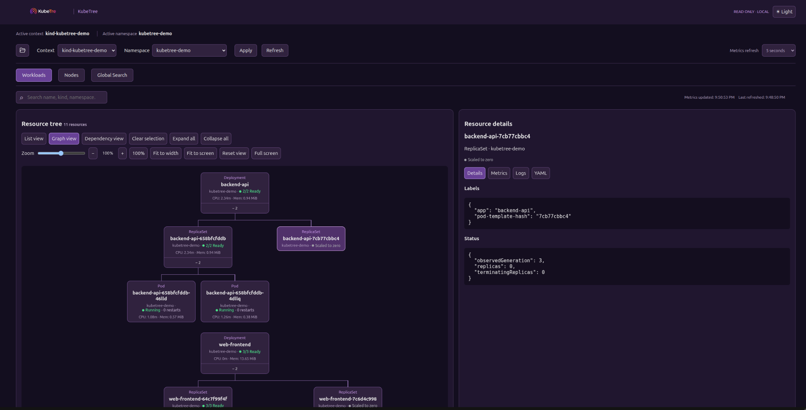
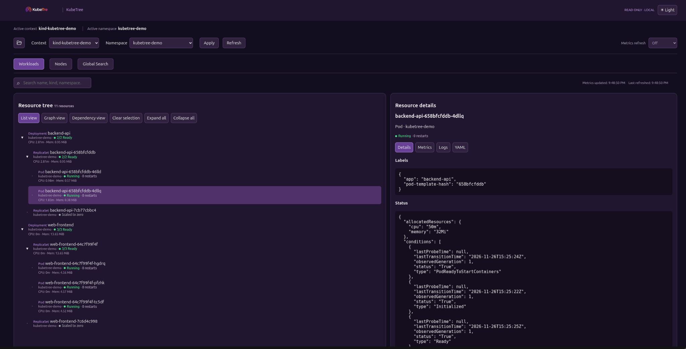
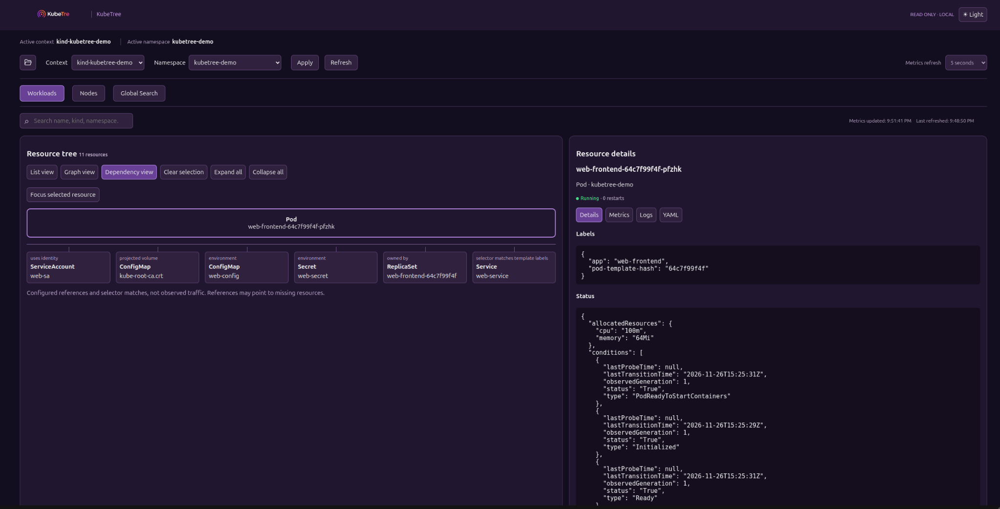
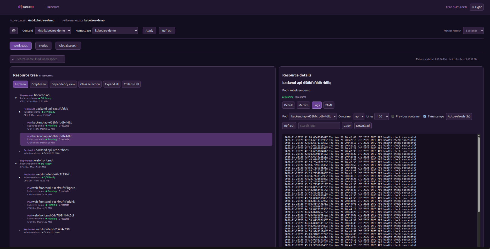
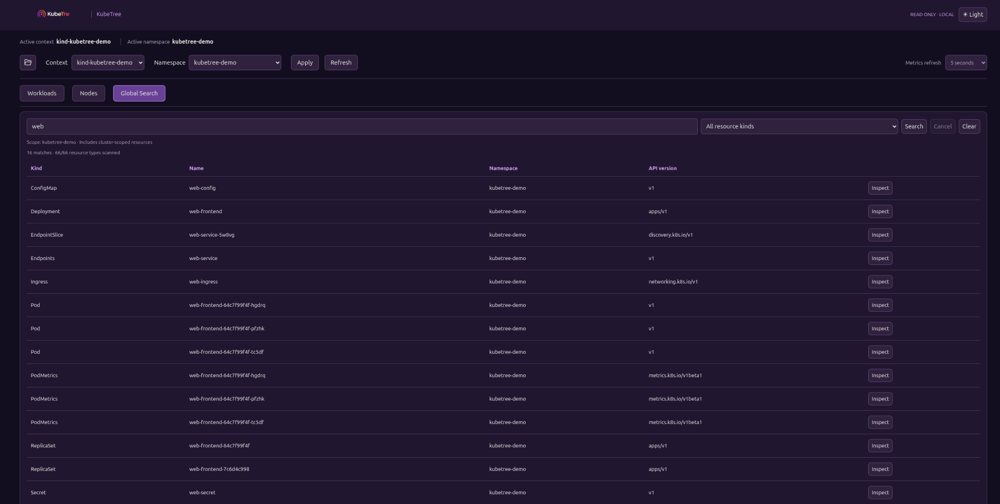
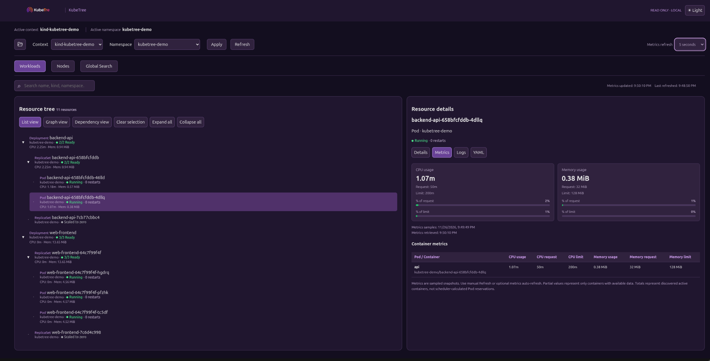
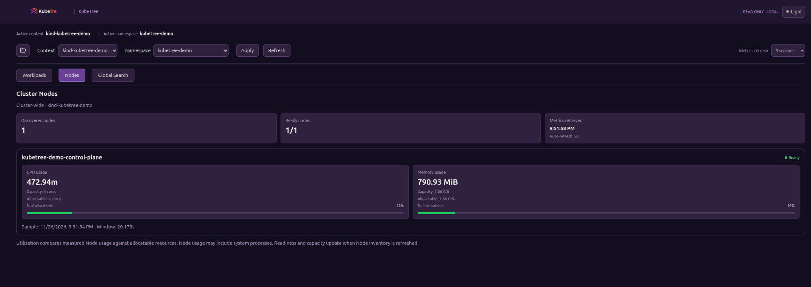

<p align="center"></p>
<h1 align="center">KubeTree</h1>
<p align="center"><strong>Visualize your Kubernetes.</strong><br>Local-first Kubernetes resource visualization and troubleshooting.</p>
<p align="center"><a href="https://github.com/kubetre/kubetree/releases"><strong>Download KubeTree</strong></a> · <a href="docs/user-guide.md">Documentation</a> · <a href="https://kubetre.com">Website</a> · <a href="https://github.com/kubetre/kubetree/issues">Support</a></p>
<p align="center">v0.1.7 · Read-only · Local-first</p>



## Quick start

You need `kubectl` on your PATH, a configured kubeconfig and access to a Kubernetes cluster. No Go or Node.js installation is required to run a downloaded binary.

```sh
kubectl config current-context
kubectl get pods -n default
```

Download the binary for your platform from [GitHub Releases](https://github.com/kubetre/kubetree/releases). Release assets become available when the release is published.

| Platform | Download |
| --- | --- |
| Linux x86-64 | [kubetree-linux-amd64](https://github.com/kubetre/kubetree/releases/latest/download/kubetree-linux-amd64) |
| Linux ARM64 | [kubetree-linux-arm64](https://github.com/kubetre/kubetree/releases/latest/download/kubetree-linux-arm64) |
| Windows x86-64 | [kubetree-windows-amd64.exe](https://github.com/kubetre/kubetree/releases/latest/download/kubetree-windows-amd64.exe) |
| macOS Intel | [kubetree-darwin-amd64](https://github.com/kubetre/kubetree/releases/latest/download/kubetree-darwin-amd64) |
| macOS Apple Silicon | [kubetree-darwin-arm64](https://github.com/kubetre/kubetree/releases/latest/download/kubetree-darwin-arm64) |
| Checksums | [SHA256SUMS.txt](https://github.com/kubetre/kubetree/releases/latest/download/SHA256SUMS.txt) |

### Linux

From the download directory:

```sh
chmod +x kubetree-linux-amd64
./kubetree-linux-amd64
```

For ARM64, substitute `kubetree-linux-arm64`.

### Windows (PowerShell)

```powershell
.\kubetree-windows-amd64.exe
```

### macOS

```sh
chmod +x kubetree-darwin-arm64
./kubetree-darwin-arm64
```

For Intel Macs, substitute `kubetree-darwin-amd64`.

Open **[http://127.0.0.1:8080](http://127.0.0.1:8080)** in your browser. Select a context and namespace and click **Apply**. Stop the server with Ctrl+C.

Linux x86-64 has been runtime-tested. Other binaries are built by CI but runtime testing is pending. Binaries are unsigned.

## Explore KubeTree

### Resource list and details

Expand ownership hierarchies, search resources and inspect labels, status and YAML. The example shows resources in the `kube-system` namespace of a local Kind demo cluster.



### Graph view

Follow Deployment → ReplicaSet → Pod relationships visually. Use zoom and expand or collapse controls to navigate the hierarchy.

### Dependency view

Select a resource to explore configured references and selector matches. This example shows a Pod's ServiceAccount and Node relationships. These are not observed network traffic.



### Container logs

Select a Pod and container, filter logs, show timestamps, copy or download output, and optionally refresh every three seconds.

<p align="center"></p>

### Configuration, Secrets and certificates

Inspect related configurations and authorized Secrets on demand, with masked values, Base64 decoding and first-PEM TLS certificate details. Never publish real Secret values or sensitive logs.

## Build from source

On Linux, install Git, Go 1.23 or newer, Node.js 22 with npm, GNU make and kubectl.

```sh
git clone https://github.com/kubetre/kubetree.git
cd kubetree
make test
make build
make run
```

The executable is generated at `bin/kubetree`, with the frontend embedded. Open http://127.0.0.1:8080.

## Security and support

KubeTree uses existing Kubernetes credentials and RBAC. It has no cluster mutation endpoints or in-cluster agent. Keep the server bound to loopback; local processes can access its API. Do not expose it to untrusted networks.

- [User guide](docs/user-guide.md) — installation, usage and troubleshooting.
- [GitHub Issues](https://github.com/kubetre/kubetree/issues) — non-sensitive bug reports and feature requests.
- [KubeTre website](https://kubetre.com) — product and company information.

See LICENSE for licensing terms.

<!-- kubetre-contact-start -->
## Contact & Support

- General enquiries: [info@kubetre.com](mailto:info@kubetre.com)
- Product support: [support@kubetre.com](mailto:support@kubetre.com)
- Private vulnerability reports: [security@kubetre.com](mailto:security@kubetre.com)
- Community support: [GitHub Issues](https://github.com/kubetre/kubetree/issues)

Please do not include credentials or confidential cluster data in public issues.
<!-- kubetre-contact-end -->


## Global Search and cluster connections

- Export KUBECONFIG before launching, or select a trusted kubeconfig using the folder icon.
- Select context and namespace, then click Apply.
- Global Search discovers Kubernetes resource metadata subject to RBAC.
- Workload metrics show CPU and memory usage.
- Nodes provides cluster-wide node information.




